# 跨資產 ETF 動能 × 波動狀態：一次完整的 ML4T 研究循環

<p class="meta">ML for Algorithmic Trading · Midterm Proposal　|　徐旻鉉　|　2026-11-08　|　setup_version v1　|　規格雜湊 <code>7e75995d042147ae</code>（holdout 執行前凍結）</p>

> **摘要**　以 100 檔跨資產 ETF（2006–2025，Yahoo Finance）建立月頻、只做多的排名策略：機制是「資金移動緩慢、投資人反應不足」造成 6–12 個月相對強弱延續，並假設高波動期間（動能崩潰）會讓這個效果失效。我依 ML4T 流程完成一圈：先寫好 `setup.yaml` 與驗證協定並封存 2024–2025 holdout → 時間點正確的資料管線 → 22 個候選特徵、五道關卡篩選（0 PROCEED／9 REVISE／8 STOP）→ 規則／Ridge／LightGBM 階梯 → 含成本、配置與風控的回測 → holdout 前的洩漏檢查 → **只跑一次** holdout。部署模型（LightGBM）在驗證期日 IC 0.078 [0.042, 0.113]、淨 Sharpe 0.63 [−0.02, 1.29]；holdout 日 IC 0.064 [−0.014, 0.142]、淨 Sharpe 1.08 [−0.31, 2.47]，**預先登錄的確認檢定通過，但兩個信賴區間都含 0**，且在 holdout 中 ML 的優勢沒有轉成投組優勢（Sharpe 低於 12-1 規則的 1.35 與 60/40 的 1.39）。Deflated Sharpe（N = 93 次試驗）只有 0.28（驗證）與 0.17（holdout）。結論：依 Ch. 20 屬於「**never resolved**」型態（兩段淨 Sharpe 區間皆含 0）；訊號方向維持，但價值在投組轉換關卡流失。另外，稽核後以重新下載的資料（調整因子僅差約 10⁻⁶）重跑開發期，Optuna 會選出不同的超參數，部署規則也改選 12-1 規則，顯示 ML 相對優勢並不穩健。證據不足以投入資金；下一步是降低轉換損失（換手），而不是再調參數。

## 1. 假說與優勢來源（Ch. 1, 6）

**機制（兩句話）**　資金移動緩慢與投資人反應不足，使跨資產 ETF 過去 6–12 個月的相對表現在下一個月延續；配置者依日曆再平衡、或錨定舊價格的投資人，是交易的對手方。這種延續在波動剛飆升之後最弱，因為崩跌過的輸家會劇烈反彈（momentum crash），所以波動狀態應該能「開關」這個訊號。

**優勢來源（Table 6.1）**　資金流可預測（flow predictability）為主，風險補償（承擔崩潰風險）為輔。採「機制優先」入口，研究範圍因此被限制在價格動能家族與少數狀態變數。

**證偽條件（事先寫入 `setup.yaml`）**　① 規則基準與部署模型的驗證期 IC 之 Newey-West 95% CI 含 0 → 停止；② 損益兩平成本 < 2 倍假設成本 → 不可交易；③ holdout 淨 Sharpe < 0 或平均 IC ≤ 0 → 未確認；④ 高波動三分位的動能 IC 不低於平靜三分位 → 波動開關機制被否定。

<div class="wcb"><b>What could break this</b>　ETF 動能的對手方是誰並不像個股那樣清楚；若跨資產動能其實只是「股債輪動 + 美股 beta」，那它是風險暴露而非優勢（第 6 節滾動 beta ≈ 0.90 顯示這個疑慮是真的）。另外，2010 年代後 CTA 與趨勢跟隨 ETF 規模擴大，可能讓延續效果被套利掉。</div>

## 2. 交易設定 v1 與驗證協定（Ch. 6）

交易設定以 YAML 寫成並在任何回測前 commit（git 第一個 commit `73fd93f`），以下為摘要；調整參數不換版本，改變機制（例如多空、加入融資成本）即升為 v2。

| 欄位 | 設定 |
|---|---|
| 股票池與資格 | 100 檔 ETF（9 類）；在 t 日收盤時：歷史 ≥ 273 交易日，且過去 63 日「未調整收盤價 × 未調整成交量」中位數 ≥ 1,000 萬美元 |
| 決策時程 | 月底最後一個交易日收盤產生分數 → 下一交易日**開盤**成交（延遲 1 個交易日），持有至下次再平衡開盤 |
| 可用資訊 | t 日收盤前的調整後 / 未調整 OHLCV；v1 不使用任何非價格資料；最長回看 252 日 |
| 分數→交易 | 依分數取前 10 名、等權 10%、只做多、滿倉；無法成交狀態：成交日無有效開盤價則不交易、保留原權重；可用標的不足 10 檔時差額持現金 |
| 限制 | 槓桿 1.0、不放空、單檔上限 10%，在模擬迴圈內每次再平衡檢查 |
| 成本類別 | 每股 $0.0035 手續費 + 分級半價差（大型 ETF 0.5¢、XL 類股 1¢、其他 2¢），以**未調整開盤價**換算 bps；壓力測試價差 ×3 |

**驗證協定（六項承諾）**　擴張式訓練窗（自 2007-01-01）；步長 1 年；每年初重訓；標籤期間 21 交易日；label buffer（purge）22 交易日（標籤讀到 open[t+22]）；embargo 0（訓練永遠在驗證之前）；最長特徵回看 252 日。資料切分如下，實際日期記錄於附錄 A2：

| 用途 | 期間 | 說明 |
|---|---|---|
| 特徵篩選（discovery） | 2008-01-01 ～ 2014-11-28 | 末端已 purge，標籤不跨入 2015 |
| 超參數調整（固定切分） | 訓練 ≤ 2013-11-27；驗證 2014-01-02 ～ 2014-11-28 | Ridge α 與 LightGBM 只在此調一次後凍結 |
| Walk-forward 驗證 | 2015 ～ 2023，共 9 個年度 fold | 每 fold 重訓，凍結超參數 |
| **Holdout（封存）** | **2024-01-01 ～ 2025-12-31** | 2026-11-08 封存；程式層級閘門 `load_panel_with_holdout` 需凍結規格才能開啟，並記錄每次存取 |

**搜尋記帳**　研究帳本 `run_log.csv` 在第一次回測前就已 commit（空表頭），採 Strategy → Trial family → Trial → Run 四層；每列記錄 git commit、資料快照雜湊、設定、評估區間、指標與決策。至 holdout 為止共 **93 個試驗**（特徵 21＝17 訊號＋4 狀態、Ridge α 10、Optuna 50、模型 4、策略 / 配置 / 覆蓋 8；帳本中的去重與部署決策紀錄列不計），這個數字直接用於第 7 節的 Deflated Sharpe。**預先登錄的確認檢定**：部署階、等權前 10、假設成本、無覆蓋；holdout 平均日 IC > 0 **且** 淨 Sharpe > 0 即通過，並附 95% CI 與 DSR。

<div class="wcb"><b>What could break this</b>　固定切分調參只用 2014 一年（約 230 天）選超參數，選到的是那一年的雜訊的風險很高；Ridge α 選在網格邊界（10⁵），代表最佳正則化可能更強。部署規則「顯著勝過最佳較簡單階」的邊際很薄（見第 5 節），而且第一次（有 bug 的）執行與修正後結果不同，這屬於 forking path，已完整揭露於附錄 A3。</div>

## 3. 資料：來源、時間點正確性與品質報告（Ch. 2–5）

**來源（路線 B，自行下載）**　Yahoo Finance via `yfinance` 1.8.0，下載時間 2026-11-08 15:19 UTC，`auto_adjust=False` 同時取得收盤價與調整後收盤價。共 470,662 列、100 檔，資料快照 SHA-256 前 12 碼 `e85bda8973a2`；用 `uv run python scripts/download_data.py` 可重新下載同一份資料（Yahoo 調整因子每次下載有約 10⁻⁶ 的浮點差異，雜湊會不同；本報告數字以快照 `e85bda8973a2` 為準，見第 5 節與附錄 A4）（Parquet 長表 `data/raw/etf_panel.parquet`，另存除權息 / 分割事件表與 metadata）。與課本 ETF 快照獨立比對：99 檔共同標的、4,529 個交易日，日報酬差超過 10bp 的比例為 0，中位差 0.0017bp。

**時間戳記與調整**　日期為 NYSE 交易日，開 / 收盤為官方 09:30 / 16:00 ET。我發現 Yahoo 的 `Close` **已經做過分割調整**（SMH 2023-05-05 一拆二當天「原始」報酬是 +2.11%），若直接拿來算每股手續費，分割前的成本會被高估或低估。因此以「分割後價格 × 之後所有分割比例」重建**實際成交價**：修正後 SMH 在除權日的未調整報酬為 −48.9%、調整後 +2.1%，美元成交量不變（已驗證）。報酬一律用調整後價格；所有以美元或股數計價的量（資格門檻、Amihud、成本）一律用重建的未調整價格。

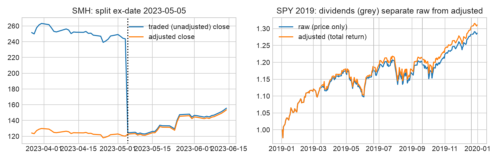
<div class="fig">圖 3.1　Q：價格調整處理正確嗎？左：SMH 分割日未調整（實際成交）vs 調整後；右：SPY 2019 除息日（灰線）使未調整與總報酬序列分離。</div>

**時間點正確性檢查（三個層次）**

{{table:02_pit_checklist.csv}}

**品質報告**　OHLC 不變式違反、非正價格、重複 (symbol, date) 皆為 0；成交量為 0 的列有 158 列（0.038%，以 VLUE、INDA 為主），處理方式是**標記並排除**（價格設為 NaN，不能進入特徵、標籤或成交），不做任何默默往前補值。相對於 NYSE 交易日曆，各檔上市後內部缺漏交易日為 0。樣本內沒有任何一檔下市（存活者偏誤，見 PIT 表的 FAIL）。每月可交易檔數中位數 87（四分位 74–93），2006 年因歷史長度不足為 0，2015 年後穩定在 85 以上（圖 3.2）。v1 不使用 tick 資料；合成資料（3 檔、60 日）只用於回測引擎的單元驗證，不進入任何結果或總表。代號檢查涵蓋 2006–2023；2024–2025 為維持 holdout 封存而未在開發期檢查。

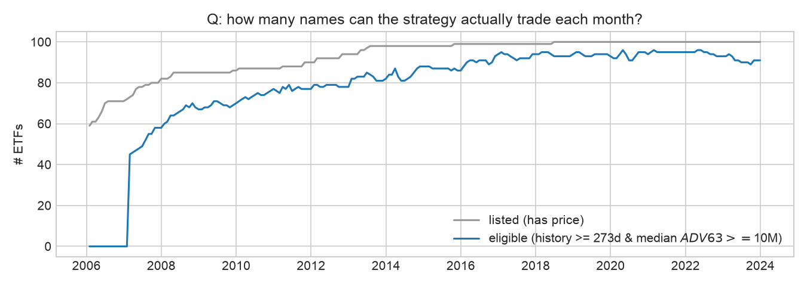
<div class="fig">圖 3.2　Q：策略每個月實際能交易幾檔？灰：有價格；藍：符合資格（歷史 ≥ 273 日且 $ADV ≥ 1,000 萬）。</div>

<div class="wcb"><b>What could break this</b>　(1) 存活者偏誤：100 檔名單是 2025 年選的，期間關掉的 ETF（多半是失敗的商品或主題型基金）不在樣本中。這主要高估等權基準；對動能多頭部位的影響方向較小（輸家本來就不太會被選中），但仍是向上偏誤。(2) Yahoo 的調整後價格會隨未來配息回溯修改，比率型特徵幾乎不變，但實測重新下載後約 10⁻⁶ 的差異仍足以改變 Optuna 選出的 LightGBM 超參數與部署模型（第 5 節），但重新下載時調整因子會變，README 已註明。(3) 半價差是依經驗分級，不是實際報價。</div>

## 4. 標籤、特徵與篩選（Ch. 7–10）

{{table:03_label_spec.csv}}

**標籤**　`fwd_open_ret_21d = open[t+22] / open[t+1] − 1`，固定期間連續報酬，錨定「t+1 開盤成交、下次再平衡開盤出場」的回測規則。同一筆觀測下，收盤對收盤與開盤對開盤標籤的平均絕對差是 **85bp**，所以兩者不能混用。訓練目標為逐日橫斷面去均值後的報酬，並以訓練 fold 估計的 1%／99% 分位做 winsorize。重疊造成名目觀測 352,620 筆，有效樣本約 16,791（÷ 21）；discovery 期 IC 序列的 Bartlett 有效天數只有 **86 天**，所以所有 IC 信賴區間都用 Newey-West（lag 21）。

**特徵表（Table 8.1 格式，每個候選一列）**　22 個候選：17 個訊號（每個都有可命名的機制與預期方向）與 5 個狀態變數；回看期 ≤ 252 日，每日計算、月頻使用。

{{table:03_feature_register_report.csv}}

所有訊號在每個決策日對**當日符合資格**的標的做橫斷面百分位排名。相關性分群（|ρ| ≥ 0.8，依特徵表順序挑代表，**不看 IC**）刪去 2 個重複：`volscaled_mom_252_21`（＝`mom_252_21`）、`max_ret_21`（＝`vol_63`）。

**關卡 1a：截斷測試**　隨機抽 6 個日期，把資料截在 t 重新計算所有特徵，在 t 的值與全樣本計算**完全相同**，所以沒有未來資訊。之後的獨立稽核又用 12 個月底日期，對完整 panel（含排名與市場層級狀態變數）重做一次，同樣全部通過。

**五道關卡篩選（discovery 2008-01 ～ 2014-11，結果 0 PROCEED／9 REVISE／8 STOP）**

**關卡 1–2、5：關聯與多重檢定**

{{table:03_triage_report_a.csv}}

**關卡 1、3–4：安慰劑、形狀與可行性，以及決策**

{{table:03_triage_report_b.csv}}

讀法：IC 為日 Spearman IC 平均與 NW 95% CI，ICIR 為日 IC 平均 / 標準差；same-sign yrs 為 7 個年度區塊中方向符合機制的比例；IC 5d / 21d / 63d 為三個期間的 IC 衰減；effect d 為以平均橫斷面樣本數換算的效果量（與 BH 一起報告）；placebo 為特徵延後 21 日的 IC（若仍存活代表是「慢速狀態代理」而非即時資訊）；單調性為五分位平均標籤的 Spearman（≥ 0.9 視為單調，0.9 的列實際值略低於 0.9）；價差與成本皆為每月 bp、以預期方向計算（成本 = 前五分位換手 × 2 倍來回成本）。**Benjamini–Hochberg（α = 0.05，17 個訊號）沒有任何特徵顯著**，這是沒有 PROCEED 的主因。

**值得記下的 STOP**　`beta_spy_126` 的 IC = 0.102 [0.023, 0.181] 是全表最大、NW 區間不含 0（名目 p = 0.011，BH 校正後不顯著），但方向與「betting-against-beta」機制**相反**；看了資料才把方向反過來，就等於一個新假說，所以在 v1 一律 STOP，並列為下一版的候選。短期反轉（`rev_21`、`rev_5`）在 ETF 上也不成立。

**狀態變數與機制檢驗（證偽條件 ④，discovery）**　以擴張式、時間點正確的三分位門檻，計算 12-1 動能 IC 在 SPY 波動三分位下的表現：低 0.091、中 −0.030、高 0.084。高波動並沒有比較差，**在 discovery 期間，機制的「波動開關」部分未獲支持**（但高波動只有 151 天，CI 很寬）。在驗證期這個結果反轉了（第 5、6 節）。

**前三名特徵的機制合理性（DAG + 四項檢查）**　圖 4.1 為 `trend_consistency_63`、`amihud_63`、`mom_63` 的 DAG：控制市場 beta／資產類別與波動狀態（干擾因子）；資金流是中介變數（不控制）；基金規模與存活是碰撞變數（絕不控制，否則會造成偽相關）。

{{table:03_mechanism_checks.csv}}

`mom_63` 在控制 beta 與資產類別後，IC 從 0.059 掉到 0.009，代表它多半是在挑「哪一類資產」而不是挑個別 ETF；`amihud_63` 在控制後仍存活，但在高波動時消失。三者都不是事件型特徵，事件時間對齊不適用。

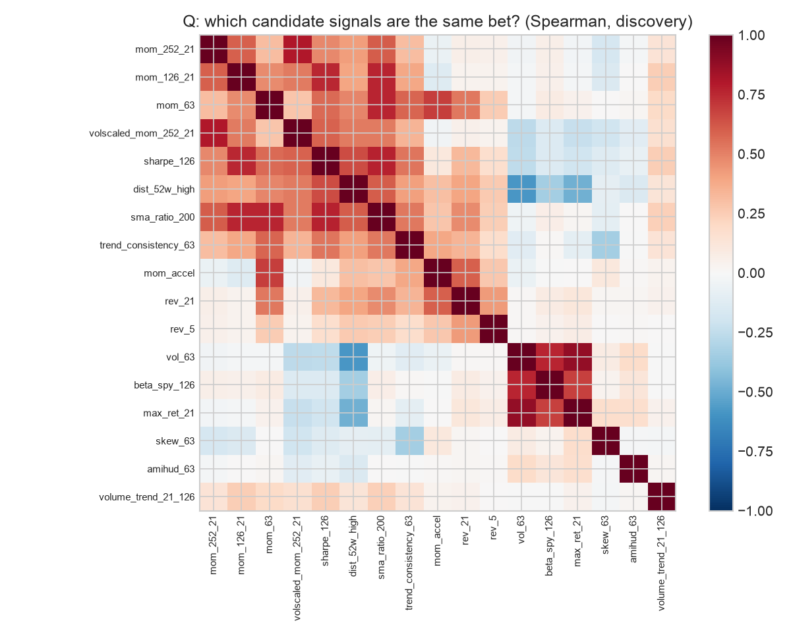
<div class="fig">圖 4.0　Q：哪些候選訊號其實是同一個賭注？discovery 期 Spearman 相關矩陣（|ρ| ≥ 0.8 者刪除）。</div>

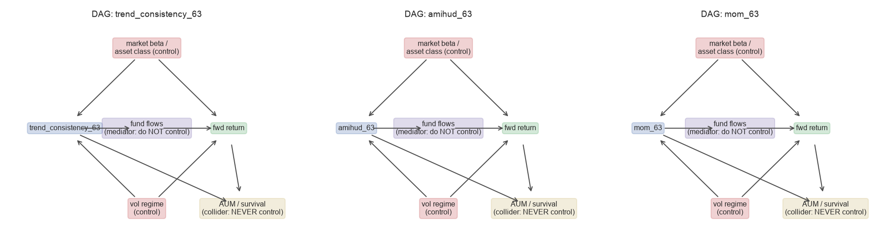
<div class="fig">圖 4.1　Q：前三名特徵各自要控制什麼、不能控制什麼？紅：干擾因子（控制）；紫：中介變數（不控制）；黃：碰撞變數（絕不控制）。</div>

<div class="wcb"><b>What could break this</b>　Discovery 只有 7 年、86 個有效 IC 天，五道關卡的檢定力很低，REVISE 的特徵進入模型其實是「寬鬆放行」；如果標準提高到只收 PROCEED，模型就沒有任何訊號特徵可用。安慰劑測試顯示，大部分動能類特徵都是慢速狀態代理，這在月頻策略中可以接受，但也表示它們和 beta / 資產類別輪動高度重疊。</div>

## 5. 模型、驗證、解讀與不確定性（Ch. 11–15）

**基準階梯**　① 規則：依 `mom_252_21` 排名（不擬合）；② Ridge：9 個 REVISE 訊號＋各自與市場波動狀態的交互作用，標準化只在訓練 fold 上 fit；α 在 10⁻⁴～10⁵（10 個值、9 個數量級）中依 2014 年 IC 選出 **10⁵**（網格邊界；與課本圖 11.1「ICIR 高峰出現在很大的 α」一致）；③ LightGBM：MAE（L1）損失、淺樹，Optuna TPE 50 次試驗，在 2014 年提早停止後凍結（num_leaves 12、max_depth 3、學習率 0.0116、min_child_samples 562、295 輪）；⑤ 集成：前三者逐日 z 分數平均。訓練列每 5 個交易日取 1 天，以降低標籤重疊。

**驗證期（2015–2023，9 fold）的共同尺度：日 Spearman IC 與 NW 95% CI**

{{table:04_ic_summary.csv}}

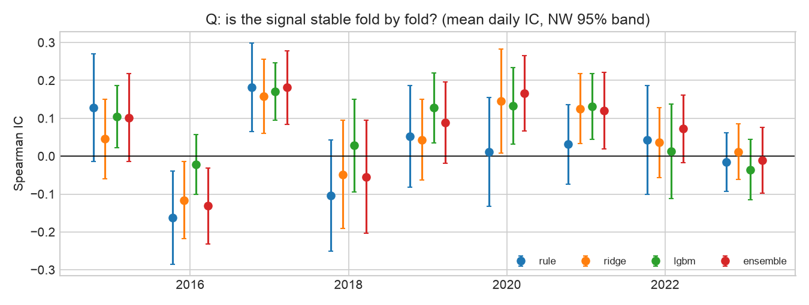
<div class="fig">圖 5.1　Q：訊號每個 fold 都穩定嗎？各 fold 平均日 IC 與 NW 95% 區間；2016、2018、2023 規則為負；LightGBM 在 2016 損失較小（−0.030 vs −0.163）、2018 轉正（+0.030），但 2023 比規則更差（−0.037 vs −0.016）。</div>

**集成的離散度**　各 fold 日 IC 的標準差：規則 0.106、Ridge 0.090、LightGBM 0.082、集成 0.106。集成沒有降低離散度（反而高於 LightGBM），所以不採用集成的理由不只是成對檢定，也包括它沒有帶來穩定性。

**成對比較（日 IC 差，NW 95% CI）與部署決策**

{{table:04_paired.csv}}

依事先登錄的規則（部署最複雜、且相對「最佳較簡單階」成對差 CI 下界 > 0 的那一階）：集成 vs LightGBM 下界 −0.042，不成立；**LightGBM vs Ridge 下界 +0.0026 → 部署 LightGBM**。這個邊際很薄，而且必須說明：稽核前的程式誤把比較對象寫成「最後一個通過的階」（規則），稽核後才改成合約文字的「最佳較簡單階」。同時修正了調參窗口的 purge，LightGBM 重新調參後，下界才從 −0.0015 變成 +0.0026（附錄 A3）。

**SHAP（描述性，非因果）**　前幾大是 `mkt_rvol_pct`、`mom_252_21`、`sharpe_126`。方向檢查：`mom_252_21`、`mom_63`、`sma_ratio_200` 的 SHAP 與特徵值正相關（符合延續機制，9 個 fold 中分別有 9／9／8 個方向一致）。**出乎意料的歸因**：`sharpe_126` 的 SHAP 與特徵值**負**相關（−0.61，9 個 fold 全部一致），和「風險調整後動能」的機制相反。我的解讀是：在已經有原始動能的情況下，高 Sharpe 往往代表低波動的債券型 ETF，模型其實是在用它降低債券權重，換句話說是資產類別效果，而不是動能本身。`mkt_rvol_pct` 是每天所有標的都相同的值，它的 SHAP 大多只是整天的水準移動，對橫斷面排名沒有影響，只有透過交互作用才有用。各 fold 重要性排名的平均 Spearman 為 0.53，屬於中度穩定。**大小合理性**：最大平均 |SHAP| 約 0.0010（相當於 21 日去均值報酬約 10bp），對照篩選表中每月 40–80bp 的五分位價差，對月頻橫斷面訊號而言是合理的量級。

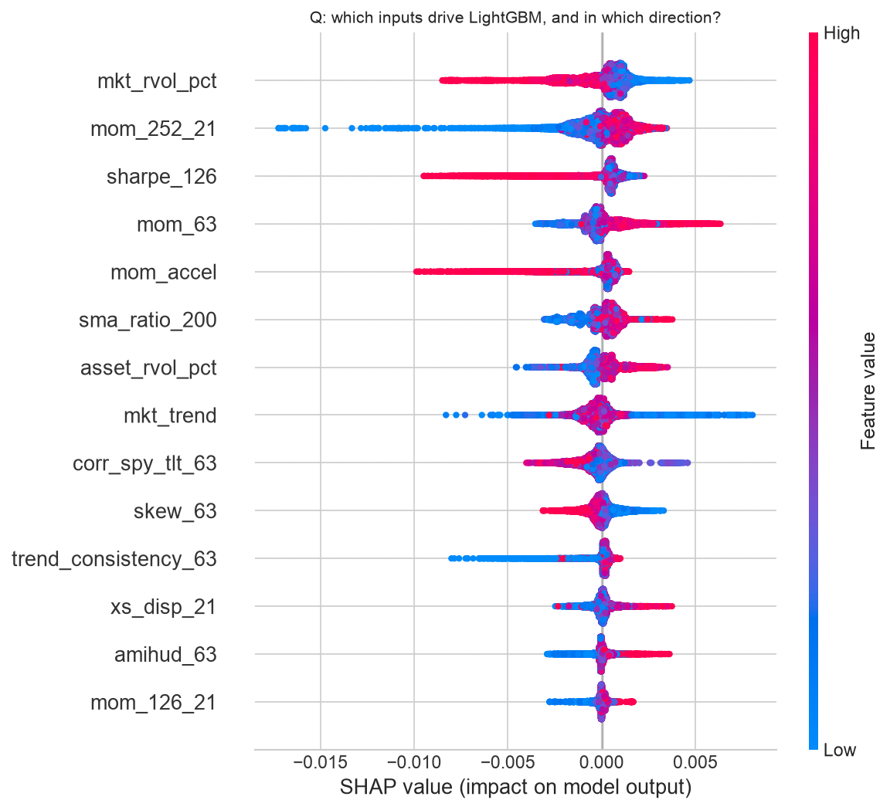
<div class="fig">圖 5.2　Q：LightGBM 依賴哪些輸入、方向為何？9 個驗證 fold 合併的 SHAP beeswarm。</div>

**Conformal 預測區間**　以每個 fold 訓練窗的最後 252 日為校準集（與核心訓練集之間再 purge 22 日）。80% 區間的實際覆蓋率在 2015（0.75）、2018（0.72）、2020（0.63）、2022（0.71）**低於 80%**，90% 區間在 2020 年只有 0.76。這四年都是波動突增的年份，和「校準過時」的預期一致。Ridge 與 LightGBM 的覆蓋率幾乎相同。

{{table:04_conformal_report.csv}}

<div class="wcb"><b>What could break this</b>　(1) LightGBM 勝過 Ridge 的證據只有一個邊際顯著的成對差，而且做了 50 次 Optuna 試驗。(2) 超參數只用 2014 年選出。(3) SHAP 顯示模型很大一部分是在做「資產類別擇時」，這在 holdout 可能表現為 portfolio-translation drift（第 7 節證實）。(4) **對資料雜訊不穩健**：最終審查以重新下載的資料（實際成交價、成交量完全相同，只有調整因子差約 2×10⁻⁶）重跑 01–05，Optuna 選出不同的超參數，LightGBM 驗證 IC 由 0.078 降為 0.065，LightGBM − Ridge 的下界變成 −0.007，依同一部署規則會改選 12-1 規則。換句話說，「部署 LightGBM」這個決定取決於浮點層級的雜訊；本報告仍依凍結的快照與規格報告，但這是 LightGBM 優勢最重要的反證。(5) 驗證與 holdout 是否一致的診斷留到第 7 節。</div>

## 6. 回測協定、基準、投組、成本與風險（Ch. 16–19）

**協定（事前固定，Table 16.2 的六項）**

{{table:06_protocol_report.csv}}

**引擎**：自寫的逐日事件迴圈（權重每日漂移）。不用純向量化，是因為波動目標覆蓋與無法成交規則會影響下一步動作。引擎另以合成資料（3 檔、60 天、已知價格）做單元測試，確認報酬與成本計算和手算一致。

**驗證期績效（2015-01 ～ 2023-12，相同協定，扣成本）**

{{table:05_performance_validation.csv:strategy,gross_sharpe,net_sharpe,net_sr_lo,net_sr_hi,net_cagr,vol,max_dd,turnover_2way_ann}}

部署模型勝過非 ML 規則（0.46）與全體等權（0.54），但**輸給 60/40（0.76）與 SPY（0.73）**。課本的 ETF 基準（Sharpe 0.65 vs 60/40 的 0.80）也有同樣不討好的結果。

**成本敏感度**　假設成本中位數每腿 3.4bp。損益兩平成本 c* = 年化毛報酬 ÷ 年化雙邊換手：部署模型 **69bp/腿**（相對等權基準 24bp），規則 126bp/腿，屬於「舒適區」。成本放大到 4 倍時淨 Sharpe 仍有 0.50，8 倍時 0.33。換手偏高：年化雙邊 16.7 倍，平均持有約 1.4 個月；規則只有 7.2 倍。

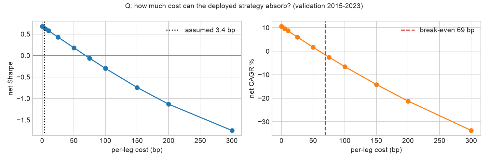
<div class="fig">圖 6.1　Q：部署策略能承受多少成本？左：淨 Sharpe 對每腿成本（虛線＝假設成本）；右：淨 CAGR 與損益兩平。</div>

**投組配置（相同訊號、相同 63 日共變異窗）**　前 10 名搭配 10% 上限時，任何滿倉配置都會退化成等權，因此改用前 20 名候選集做對照比較：

{{table:05_allocators.csv}}

最佳與最差的差距只有 0.035 Sharpe，比不同訊號之間的差距小一個數量級，與課本中位數 0.49「配置救不了弱訊號」的結論一致；這裡沒有使用 mean-variance，所以不需要 Ledoit-Wolf。

**風險控制矩陣（Table 19.2 精簡版）**

| 風險 | 代理指標 | 控制 | 頻率 |
|---|---|---|---|
| 市場 | 對 SPY 的滾動 252 日 beta（平均 0.90，HAC 區間 0.81–0.99；最低 0.75 於 2019-11，最高 1.15 於 2018-01） | 波動目標覆蓋；停損階梯 | 每日監看、每月行動 |
| 因子 / 集中 | 資產類別權重、HHI、有效標的數 | 單檔 ≤ 10%；前 10 名 | 每次再平衡 |
| 槓桿 | 總曝險 | ≤ 1.0，在模擬內檢查 | 每次再平衡 |
| 流動性 | 63 日美元成交量中位數 | 資格門檻 ≥ $10M；成交日缺價不交易 | 每月 |
| 模型 | 滾動 63 日 IC、PSI、conformal 覆蓋率 | 重訓 / 暫停規則（第 8 節） | 每月 |
| 作業 | 資料快照雜湊、holdout 存取紀錄、規格雜湊 | 程式閘門與 git | 每次執行 |

{{table:05_var.csv}}

**尾端與路徑風險**　每日歷史 VaR95 為 1.62%，CVaR95 為 2.55%；高波動狀態下分別是 2.03% 與 3.08%，低波動狀態下 1.20% 與 1.90%。最大回撤 −29.9%：2020-02-14 到 2020-03-23 共 26 個交易日，114 個交易日後（2020-09-02）才回到前高。

**壓力測試（價差 × 3，只放大價差、不放大手續費）**

{{table:05_stress.csv}}

COVID 期間部署模型（−15.3%）比規則（−9.8%）和 60/40（−6.1%）更差。2022 年升息衝擊時是 −9.9%，比 60/40 的 −16.5% 好，但規則反而 **+9.7%**（12-1 動能及早轉進能源與美元）。

**波動目標覆蓋（10%，只用 t−1 資訊；有／無覆蓋並列）**　加上覆蓋後淨 Sharpe 由 0.63 **降到** 0.54，最大回撤由 −29.9% 縮小到 −20.5%，平均曝險 0.73。覆蓋只是降低風險，並沒有創造報酬；它也不是讓策略轉正的原因（「overlays refine, never redeem」）。

**停損階梯（Table 19.7 格式）**

{{table:06_killswitch_report.csv}}

驗證期依「回撤事件」計算各觸發 8／5／5／1 次（圖 7.6），20% 只在 2020 年 3 月觸發。v1 的停損階梯是**事後計數，沒有在模擬中執行**（只有波動目標覆蓋有模擬），所以不能說「加了停損會更好」。

**統計推論（驗證期）**　淨 Sharpe 0.63，95% CI [−0.02, 1.29]；PSR(SR>0) = 0.97；偏態 −0.82、峰態 12.2。依帳本 N = 93 次試驗計算的 **DSR = 0.28**（零技能下預期最大 Sharpe 0.84）；若只計 8 個策略層級配置，DSR = 0.67。最短紀錄長度依課本公式為 15 年，依 Bailey–López de Prado 公式為 7.0 年。

<div class="wcb"><b>What could break this</b>　beta 0.90 表示策略大部分報酬來自美股多頭，2015–2025 恰好是美股強勢期；換到股市橫盤的十年，策略與 60/40 的差距可能更大。換手 16.7 倍在成本上沒有問題，但代表模型的排名不穩定。壓力測試只有兩段，而且兩段都在驗證期內，參數也是看過驗證期之後才「固定」的。</div>

<div class="break"></div>

## 7. 結果、診斷與下一步（Ch. 20）

**Holdout 只執行一次**：2026-11-08 23:39（`results/holdout_access.log`：touch #1，spec `7e75995d042147ae`）。執行前用開發期資料（2022–2023 代替 holdout）做過完整的試跑，確認程式不會中途當掉、需要第二次觸碰。

{{table:07_headline.csv}}

**結果型態（Ch. 20 五型）**　**never resolved**：驗證期與 holdout 的淨 Sharpe 區間都跨 0（[−0.02, 1.29] 與 [−0.31, 2.47]）；IC 方向維持（驗證期 CI 不含 0，holdout 含 0）。預先登錄的確認檢定**通過**：holdout 平均 IC 0.064 > 0、淨 Sharpe 1.08 > 0。但 IC 的 95% CI [−0.014, 0.142] 與 Sharpe 的 CI [−0.31, 2.47] 都含 0；兩年日資料的 Sharpe 標準誤約 ±0.7，1.08 和 0 在統計上幾乎無法區分。

**Holdout 各階的訊號與投組結果（同一凍結規格）**

{{table:06_holdout_ic.csv}}

{{table:06_holdout_performance.csv:strategy,gross_sharpe,net_sharpe,net_sr_lo,net_sr_hi,net_cagr,vol,max_dd,turnover_2way_ann}}

**各階段在 holdout 的比較**　訊號端，LightGBM 的 IC（0.064）仍高於規則（0.049），Ridge 最高（0.076）。投組端卻**相反**：淨 Sharpe 規則 1.35、Ridge 1.36、等權 1.31、60/40 1.39、SPY 1.27，部署模型 1.08 墊底。毛 Sharpe 1.11 對淨 1.08，成本並不是原因。

**診斷**　(1) **價值在哪一關流失**：不是訊號關（IC 方向維持）、不是成本關（兩平 128bp），而是 **portfolio gate**：IC 穩定、Sharpe 下降，這是 Ch. 20 定義的 **portfolio-translation drift**。2024–2025 是全面多頭（等權 Sharpe 1.31），在 beta 主導的市場中，換手 14 倍、前 10 名集中的排名轉換，把小幅的 IC 優勢吃掉了。(2) **市場狀態**：holdout 只有 42 天屬於「高波動 / 下跌趨勢」，沒有「低波動 / 下跌」，等於沒有真正的空頭可以檢驗波動開關。(3) **機制**：證偽條件 ④ 在驗證期**沒有**被觸發：動能 IC 平靜 0.095 [0.022, 0.169]、中 0.032、壓力 −0.075 [−0.160, 0.011]，支持波動開關；但在 discovery 期被否定。兩段資料互相矛盾，所以只能說「未定」。(4) **限制因素**：construction robustness（排名→權重的轉換不夠穩健）。(5) **ML 優勢本身不穩健**：重新下載資料重跑開發期會改選 12-1 規則（第 5 節）；holdout 中 Ridge 的 IC（0.076）也高於 LightGBM。驗證期各狀態的最差回撤：高波動 / 下跌 −20.4%、高波動 / 上漲 −19.0%、低波動 / 上漲 −16.9%。

**唯一的下一步**　**把部署模型的分數先做 3 個月指數平滑再取前 10 名，把換手壓到與規則同級（≈ 6–7 倍/年），然後用同一個 walk-forward 協定重測 portfolio gate。** 這屬於映射規則的改變，是 setup v2，需要新的 holdout（例如 2026 年起的前推資料）。不再調模型參數。依課本結論，這個第一輪策略不直接投入資金。

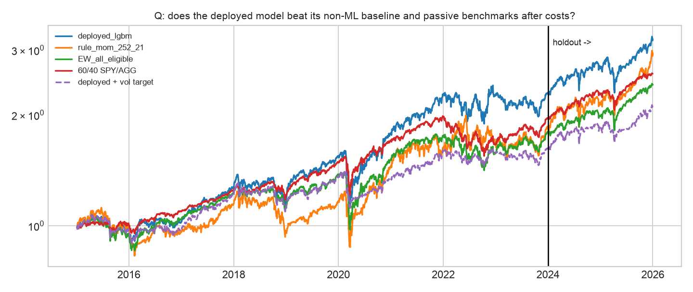
<div class="fig">圖 7.1　Q：部署模型在扣成本後是否勝過非 ML 基準與被動指標？黑線為驗證／holdout 分界。holdout 中規則縮小了差距（holdout 累積 +55.9% vs 部署 +38.7%），但整段累積報酬仍是部署模型領先（+219% vs +190%）。</div>

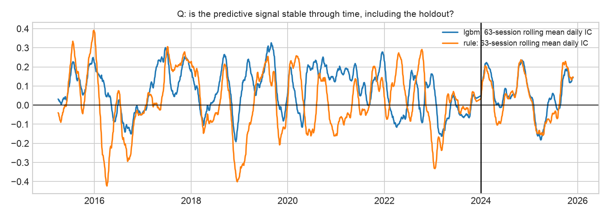
<div class="fig">圖 7.2　Q：預測訊號在時間上穩定嗎？63 日滾動平均日 IC；2016、2018、2022、2023 年有較長的負區段（2017、2019、2020 也有短暫負值）；holdout 大致為正，但 2025 年（主要在上半年，關稅衝擊前後）有負值。</div>

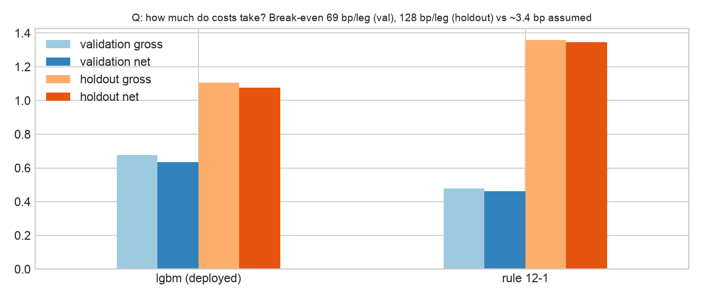
<div class="fig">圖 7.3　Q：成本吃掉多少？毛 vs 淨 Sharpe；成本不是瓶頸（兩平 69bp 驗證／128bp holdout vs 假設 3.4bp）。</div>

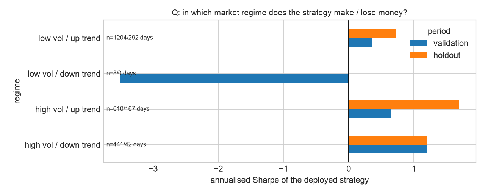
<div class="fig">圖 7.4　Q：策略在什麼市場狀態賺／賠錢？狀態門檻用 t−2 收盤、擴張式中位數（時間點正確）；「低波動 / 下跌」只有 8／0 天，不具解讀價值。</div>

圖 7.5（SHAP beeswarm）即圖 5.2。

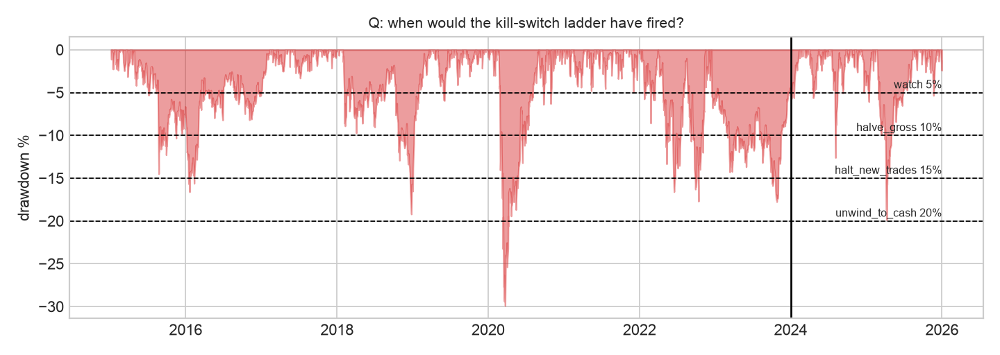
<div class="fig">圖 7.6　Q：停損階梯什麼時候會觸發？虛線為 5／10／15／20% 門檻；20% 只在 2020 年 3 月觸發，holdout 最深 −19.9%（2025 年 4 月關稅衝擊）。</div>

<div class="wcb"><b>What could break this</b>　holdout 只有兩年，又是罕見的全面多頭；「確認檢定通過」很可能只是 beta 的功勞（holdout 中連等權都有 1.31）。DSR 0.17 表示在 93 次試驗下，這個 Sharpe 不足以排除運氣。</div>

## 8. 監控與部署計畫（Ch. 25–26，設計而非實作）

**一致性（parity）**　實盤與回測共用同一個 `etfmom` 套件：資料 → 特徵 → 預測 → 訊號 → 委託，每一層存快照並計算雜湊，逐層比對回測與實盤（原始價格、特徵值、預測排名、目標權重、成交價差）。**監控**：每月計算 30／60／90 日滾動 Sharpe、回撤、命中率、IC，以及實盤 / 回測的實現比率（< 0.5 連續 3 個月就調查）。**漂移**：前 5 大特徵的 PSI（0.10–0.25 觀察，> 0.25 重訓），加上 SHAP 排名檢查（前 5 名有 2 個以上換掉即調查）；conformal 覆蓋率 < 80% 代表校準過時。**生命週期**：每年初例行重訓；60 日 IC < 0 而且 PSI > 0.25 → 暫停；連續 12 個月 IC 的 NW CI 上界 < 0、或回撤 ≥ 20% → 退場；正式投入資金前至少 6 個月影子交易（shadow mode）。**區分三種失效**：技術 bug（parity 某一層出現斷點 → 修程式，不重訓）、統計衰退（IC 與 PSI 同時惡化 → 重訓或退場）、成本膨脹（毛 Sharpe 穩定、淨 Sharpe 下滑或實際價差 > 假設 2 倍 → 降低再平衡頻率）。

<div class="wcb"><b>What could break this</b>　月頻策略一年只有 12 個決策點，30 日監控指標的雜訊遠大於訊號；觸發門檻需要用影子交易期的資料重新校準，而不是直接沿用回測分布。</div>

<div class="break"></div>

## 附錄 A　研究帳本、執行紀錄、程式庫地圖

### A1. 研究帳本摘要（`run_log.csv`，共 196 列 run）

| Trial family | 試驗數 | 內容 | 評估窗 |
|---|---|---|---|
| feature_triage | 21（+ 去重紀錄 1） | 17 訊號五道關卡、4 狀態三分位 | discovery 2008-01 ～ 2014-11 |
| ridge_alpha | 10 | α = 10⁻⁴ … 10⁵ | 2014 調參窗 |
| lgbm_optuna | 50 | TPE、提早停止 | 2014 調參窗 |
| model_ladder | 4（+ 部署決策 1） | rule / ridge / lgbm / ensemble | 驗證 2015–2023 |
| strategy_backtest、allocator、risk_overlay | 8 | 4 策略、3 配置、1 覆蓋 | 驗證 2015–2023 |
| holdout | 1 | 確認檢定（PASS） | 2024–2025，唯一一次 |

試驗次數依 (family, trial) 去重計算，決策與去重紀錄列不計入（N = 93）。帳本 1–103 列是稽核前的第一次執行（含一次只改報表的重跑），104–195 列是稽核修正後的重跑，196 列是 holdout 確認檢定；同一個試驗名稱不重複計數，但兩次的結果都保留在帳本中。

### A2. Walk-forward 切分日期（交易日，purge 22）

{{table:04_fold_dates.csv}}

Holdout fold：2024 年模型 train_end 2023-11-28；2025 年模型 train_end 2024-11-27（依同一協定以 2024 年資料重訓，屬於凍結規格的一部分）。 `run_log.csv` 的 eval_window 欄只記錄整段區間；各 fold 的切分日期以本表（`results/tables/04_fold_dates.csv`）為準。gate 欄只在有關卡的試驗家族（特徵篩選、部署決策、holdout）填寫。

### A3. Holdout 前的洩漏檢查（5 個面向，每個發現再反向驗證）

已確認並修正的問題：(1) discovery 與調參窗的**末端**沒有 purge，2014 年最後 22 日的標籤讀到 2015 年開盤 → 改成窗口截在 2014-11-28；(2) 部署規則的實作與合約文字不一致 → 改用「最佳較簡單階」；(3) 帳本的 git commit 欄位沒有把未追蹤的新檔案算成 dirty。低嚴重度的修正包括：波動覆蓋改成不使用成交當天的開盤價、狀態標籤延遲由 t−1 改為 t−2、壓力測試只放大價差、刪除尾端多出來的零報酬日、缺價時確保總曝險 ≤ 1、試驗數排除紀錄列、新增 Bailey–López de Prado 的 MinTRL。修正後 03–05 全部重跑。修正前後部署模型都是 LightGBM，但成對檢定的結論是在修正後才成立，已在第 5 節揭露。**沒有發現特徵、標籤、purge 或回測引擎有前視偏誤。**

交件前另做一次最終檢查：依評分表逐條對照、把文中數字與結果表逐一核對，並從乾淨的 git clone 依 README 重跑一次。核對出的文字與數字錯誤已修正；重跑發現的資料雜訊敏感度已寫入第 5、7 節。

### A4. 程式庫地圖與重現方式

```
setup.yaml                 交易設定 v1（合約）          run_log.csv           研究帳本
src/etfmom/                data / features / models / backtest / metrics / ledger
scripts/download_data.py   重建資料集                   scripts/run_notebooks.py  執行 01–05（06、07 需明示）
scripts/freeze_spec.py     凍結規格（holdout 閘門需要）  scripts/build_report.py   產生本 PDF
notebooks/01_setup … 07_results（.py 為原始碼，.ipynb 為執行結果）
results/tables, results/figures, results/holdout_access.log
```

**時間軸聲明**　所有階段都在 2026-11-08 同一個工作階段內完成（commit `73fd93f` → 交件，23:17 起），並非橫跨六週。能證明「協定先於結果」的是 commit 的**順序**：`setup.yaml` 與空帳本（`73fd93f`）先於資料（`e1582a7`），資料先於任何回測（`0f477e4`），凍結規格（`b983dbb`）先於唯一一次 holdout 觸碰（`8cd248b`）；git 歷史未改寫。

**重現**　(a) 重現 holdout 與總表：`uv sync` → `uv run python scripts/download_data.py` → `HOLDOUT_RERUN=1 uv run python scripts/run_notebooks.py 06 07`（使用已 commit 的凍結規格；以新下載的資料，最終審查實測 holdout 淨 Sharpe 1.10，原值 1.08）。(b) 重跑開發期 01–05：會覆寫 `results/artifacts/*.json`，使凍結規格的雜湊檢查拒絕執行 06（`git checkout results/` 可還原），而且如第 5 節所述，部署模型可能改變；每次重跑也會在帳本新增列。數字差異的其他來源：LightGBM 多執行緒（已設 `deterministic`、seed 42）。
